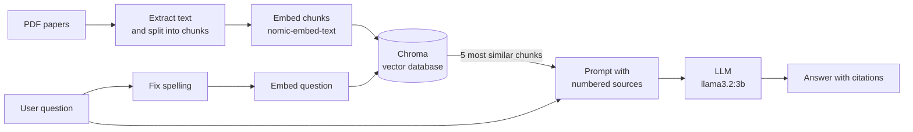

# Research Paper Chatbot

A chatbot that answers questions about my research papers using **Retrieval-Augmented Generation (RAG)**. Every answer is based only on the papers themselves and cites the paper and page it came from, so you can check it.

Everything runs locally and for free: the language model runs on your own machine through [Ollama](https://ollama.com), and no API keys or paid services are needed.

## Features

- **Answers grounded in the papers** — the model is instructed to answer only from retrieved passages and to say so when the papers don't contain the answer
- **Citations** — every answer lists its sources with paper name and page number
- **Spelling correction** — typos in questions are fixed before searching, with a safety check that rejects corrections that change the question too much
- **Chat interface** in the browser, built with Streamlit
- **One-command setup** with Docker Compose

## How it works



1. **Ingestion** — text is extracted from each PDF and split into overlapping chunks of about 1,000 characters, each tagged with its paper and page number.
2. **Indexing** — each chunk is turned into an embedding (a vector representing its meaning) and stored in a Chroma vector database.
3. **Retrieval** — the question is spell-checked, embedded, and used to find the most similar chunks.
4. **Generation** — the original question and the retrieved chunks are sent to the LLM, which is instructed to answer only from those sources and cite them.

## Tech stack

| Component | Tool |
|---|---|
| PDF text extraction | [pypdf](https://pypi.org/project/pypdf/) |
| Embeddings | `nomic-embed-text` via Ollama |
| Vector database | [Chroma](https://www.trychroma.com/) |
| Language model | `llama3.2:3b` via Ollama |
| Interface | [Streamlit](https://streamlit.io/) |
| Packaging | Docker and Docker Compose |

## Quick start (Docker)

**Requirements:** [Docker Desktop](https://www.docker.com/products/docker-desktop/) (or Docker Engine with Compose), and about 6 GB of free disk space for the images and models.

```bash
git clone https://github.com/DominiqueGeissler/research_paper_chatbot.git
cd research_paper_chatbot
docker compose up --build
```

When the logs show `Setup done`, open **http://localhost:8501**.

The **first run takes a while** (often 10–20 minutes): it downloads the models (about 2.5 GB) and builds the search index from the papers. Both are stored in Docker volumes, so later starts take only seconds.

To stop: press `Ctrl+C`, or run `docker compose down`.

> **Note on speed:** inside Docker, Ollama runs on the CPU by default, so answers can take from several seconds to a minute.

## Running without Docker

For development, you can run everything directly on your machine.

**Requirements:** Python 3.12 and [Ollama](https://ollama.com/download).

```bash
# 1. Download the models
ollama pull llama3.2:3b
ollama pull nomic-embed-text

# 2. Create and activate a virtual environment
python -m venv .venv
.venv\Scripts\Activate.ps1        # Windows (PowerShell)
source .venv/bin/activate         # macOS / Linux

# 3. Install dependencies
pip install -r requirements.txt

# 4. Build the search index
python src/ingest/ingest.py
python src/retrieval/build_index.py

# 5. Start the app
streamlit run ui/app.py
```

There are also two terminal tools, useful for testing:

- `python src/retrieval/search.py` — shows which chunks are retrieved for a question, without the LLM
- `python src/generation/ask.py` — asks questions in the terminal and prints answers with sources

## Project structure

```
research_paper_chatbot/
├── data/
│   └── papers/               # the PDF papers
├── scripts/
│   └── prepare.py            # first-start setup in Docker
├── src/
│   ├── ingest/ingest.py      # PDF → text chunks
│   ├── retrieval/
│   │   ├── build_index.py    # chunks → embeddings → Chroma
│   │   └── search.py         # test retrieval in the terminal
│   └── generation/ask.py     # prompts, spelling correction, answering
├── ui/app.py                 # Streamlit chat interface
├── Dockerfile
├── docker-compose.yml
└── requirements.txt
```

## Using your own papers

1. Replace the PDFs in `data/papers/` with your own.
2. Rebuild the search index:
   - **Docker:** stop the app, delete the index volume, and start again:
     ```bash
     docker compose down
     docker volume rm research_paper_chatbot_chroma_data
     docker compose up --build
     ```
     (Run `docker volume ls` to see the exact volume name.)
   - **Without Docker:** run `ingest.py` and `build_index.py` again.

The models and settings (such as how many chunks are retrieved) can be changed at the top of `src/generation/ask.py`.

## The papers

Pdfs are from [arXiv](https://arxiv.org/).

| File | Paper                                                                                                                                      |
|---|--------------------------------------------------------------------------------------------------------------------------------------------|
| `child_safety.pdf` | *Analyzing Social Media Claims regarding Youth Online Safety Features to Identify Problem Areas and Communication Gaps, CSCW 2026*         |
| `digital_literacy.pdf` | *Designing Effective Digital Literacy Interventions for Boosting Deepfake Discernment, CHI 2026*                                           |
| `hatespeech_resharing.pdf` | *Analyzing User Characteristics of Hate Speech Spreaders on Social Media, WWW 2025*                                                        |
| `hqp_propaganda.pdf` | *HQP: A Human-Annotated Dataset for Detecting Online Propaganda, ACL Findings 2023*                                                        |
| `prompt_engineering.pdf` | *The Effect of Education in Prompt Engineering: Evidence from Journalists, ICWSM 2026*                                                     |
| `propaganda_spread.pdf` | *Russian propaganda on social media during the 2022 invasion of Ukraine, EPJ Data Science 2023*                                            |
| `propaganda_strategy.pdf` | *Analyzing the Strategy of Propaganda using Inverse Reinforcement Learning: Evidence from the 2022 Russian Invasion of Ukraine, CSCW 2024* |
| `urban_mobility.pdf` | *Hyperlocal monitoring of urban activity reveals responses to heat exposure, arXiv 2026*                                                   |

